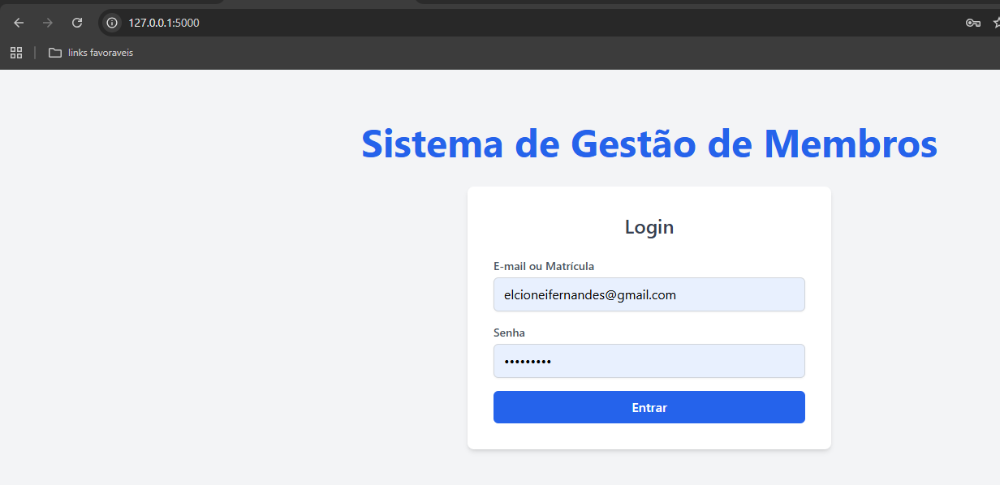
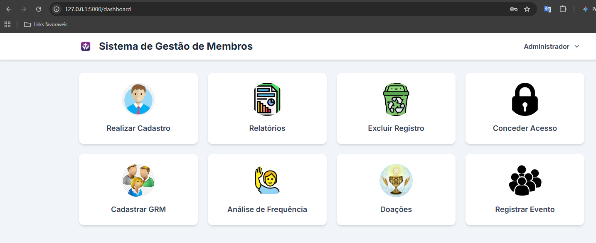
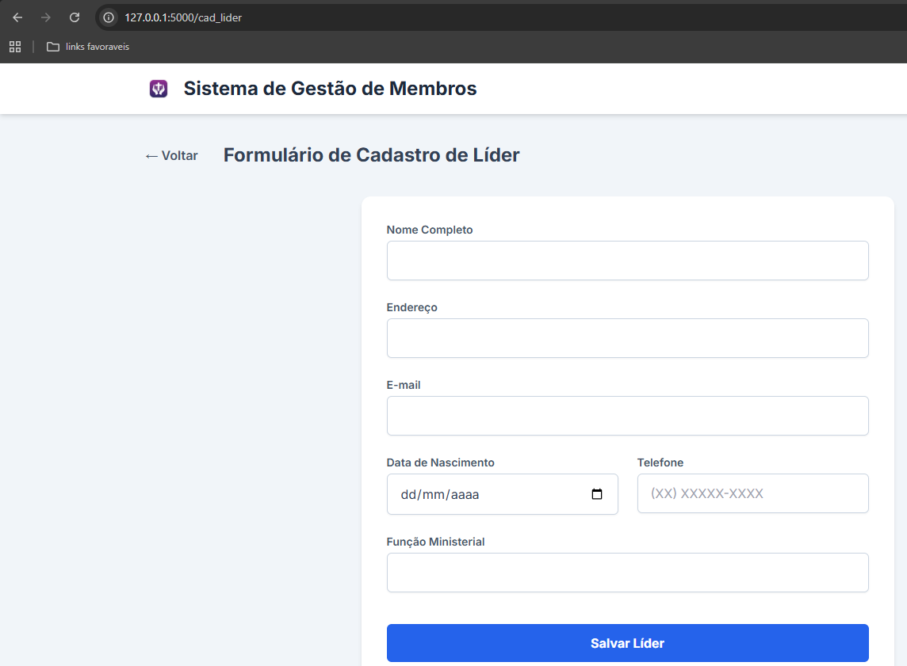
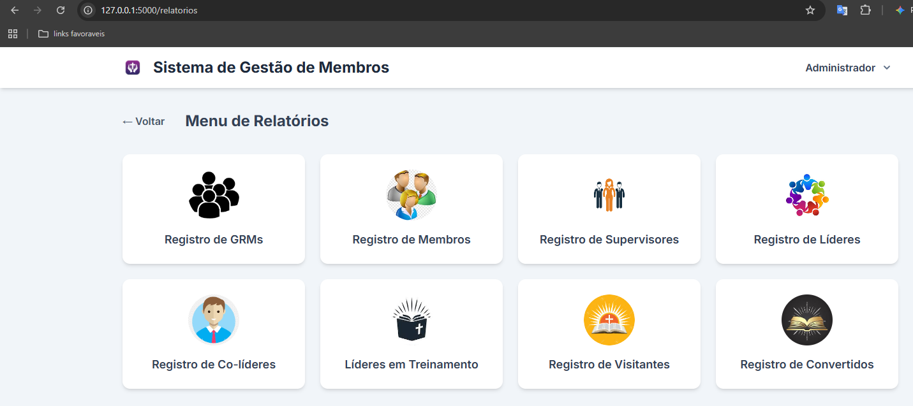
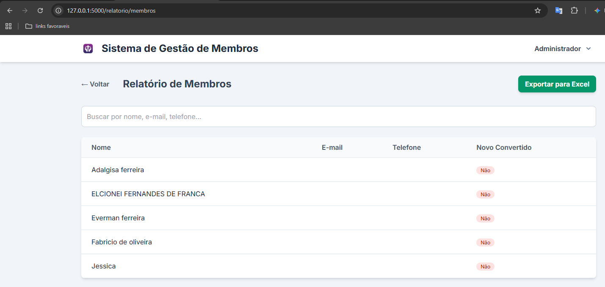
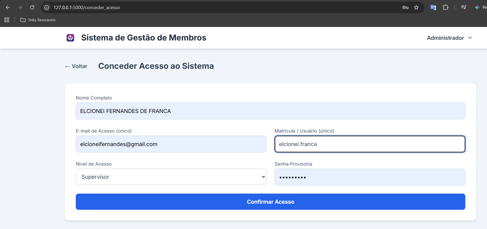

# Sistema de Gestão Ministerial (Flask + Neo4j)

Aplicação web full-stack desenvolvida em **Python (Flask)** e **Neo4j** para gerenciamento de ministérios, regiões, GRMs (grupos), lideranças, membros, visitantes, eventos, ofertas e novos convertidos.

O projeto foi migrado de uma arquitetura relacional (MySQL) para um **banco de dados em grafos (Neo4j)**, modelando nativamente a hierarquia ministerial e os vínculos entre pessoas, grupos e eventos.

---

## Arquitetura e Tecnologias

- **Backend:** Python 3, Flask (arquitetura modular separada em `app.py`, `database.py`, `utils.py` e `routes/`)
- **Banco de Dados:** Neo4j (Cypher) com constraints de unicidade para credenciais
- **Frontend:** HTML5, Tailwind CSS, JavaScript (Fetch API)
- **Relatórios:** Pandas e OpenPyXL (exportação direta para Excel `.xlsx`)
- **Segurança:** Controle de acesso baseado em perfis (RBAC), login por e-mail ou matrícula única, senhas com hash (Werkzeug) e variáveis de ambiente (`.env`)

---

## Principais Funcionalidades

- **Autenticação e RBAC:** 5 níveis de permissão (`DEVELOPER`, `SUPERVISOR`, `LIDER`, `COLIDER`, `MEMBRO`), com troca obrigatória de senha no primeiro acesso e visibilidade dinâmica de menus por perfil.
- **Cadastros Completos:** Supervisores, Líderes, Co-líderes, Líderes em Treinamento, Membros, Visitantes, GRMs, Eventos e Convertidos.
- **Relatórios e Exportação Excel:** Listagens com busca em tempo real e geração de planilhas `.xlsx` em memória para todos os módulos e histórico de ofertas.
- **Análises Gerenciais:** Filtros dinâmicos por período, cargo, região e GRM com exportação em planilha.
- **Gestão de Registros:** Busca assíncrona (`/api/search`), visualização de detalhes em modal e exclusão segura.

---

## Capturas de Tela

### Banco de Dados em Grafos (Neo4j)


### Tela de Login



### Dashboard Principal



### Cadastro de Liderança



### Menu de Relatórios



### Registro de Membros



### Conceder Acesso (E-mail e Matrícula Únicos)



---

## Como Executar Localmente

1. **Clone o repositório:**
   ```bash
   git clone [https://github.com/ELCIONEI/Gestao-Ministerial.git](https://github.com/ELCIONEI/Gestao-Ministerial.git)
   cd Gestao-Ministerial
   ```
